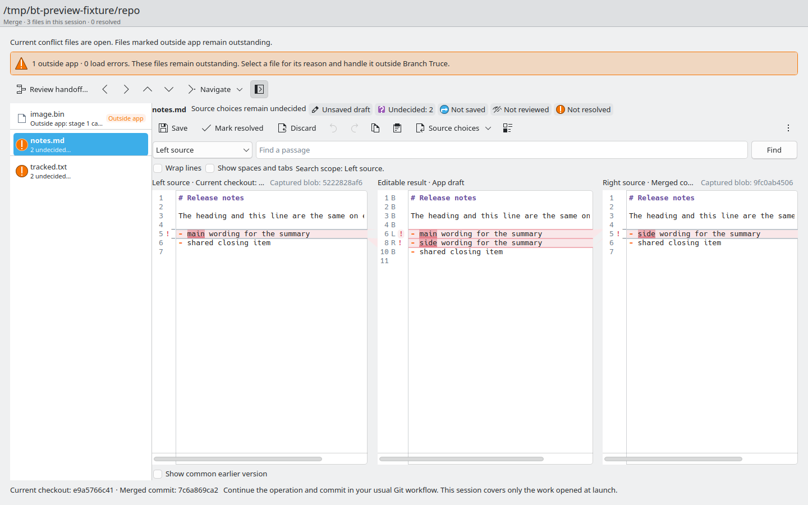

<h1>
  <picture>
    <source media="(prefers-color-scheme: dark)" srcset="assets/branding/svg/for-dark/branch-truce-horizontal.svg">
    
  </picture>
</h1>

Resolve the text conflicts of a stopped Git merge or rebase in a KDE desktop window. Branch Truce shows both sides next to an editable result, works offline and can run as Git's merge tool.

<picture>
  <source media="(prefers-color-scheme: dark)" srcset="docs/images/comparison-dark.png">
  
</picture>

## Install

Download the package for your system from the [latest release](https://github.com/e0ipso/branch-truce/releases/latest):

- Kubuntu 26.04: `branch-truce_<version>_amd64-ubuntu26.04.deb`
- Tuxedo OS 24.04: `branch-truce_<version>_amd64-tuxedo24.04.deb`

Then install it with apt, which also installs Git, Qt and Kirigami if they are missing:

```sh
sudo apt install ./branch-truce_*_amd64-ubuntu26.04.deb   # or the tuxedo24.04 file
```

Packages built from these sources install and run in containers of both bases, but nobody has run them on a real Kubuntu or Tuxedo OS desktop yet. [docs/platform-validation.md](docs/platform-validation.md) lists what was tested. To build from source, see [docs/build.md](docs/build.md).

## Use it

Start Branch Truce in a repository where a merge or rebase stopped on conflicts:

```sh
branch-truce                     # the repository in the current directory
branch-truce /path/to/repository # or a subdirectory of it
branch-truce --help
```

The window lists every conflicted file. Starting it changes neither the worktree nor the index. Two actions finish a file:

- **Save** keeps a draft inside Branch Truce. The repository file and the index stay as they were.
- **Mark resolved** writes the result to the repository file and stages that one path. If either step fails, the file stays outstanding and shows which step failed.

Branch Truce never continues the merge or rebase. Run `git merge --continue`, `git rebase --continue` or `git commit` yourself. To open it from `git mergetool`, see [docs/mergetool.md](docs/mergetool.md).

## What it does

- **Three panes.** The left and right sources sit on either side of the editable result. The common earlier version opens on demand.
- **Take a side or both.** Accept or ignore each side of a conflict, or take both in either order. You can also replace the whole file from one side, or apply only the changes that do not conflict. Typing and choices share one undo history.
- **Word-level differences.** Changed lines mark the words that differ, on top of syntax highlighting for the file's language.
- **Recovery.** Branch Truce journals edits and choices as you work. After a crash or a closed window, the next start for the same merge or rebase brings them back.
- **Git's merge tool.** Once [registered](docs/mergetool.md#register-the-tool), `git mergetool --tool=truce` hands each path to one Branch Truce window and waits until you mark it resolved or leave it.
- **Nothing hidden.** Files it cannot edit stay in the list, marked Outside app or Load error, with the reason.
- **Offline.** No account and no network. It reads the repository through the installed Git.

## Development

Build, test, preview and install steps are in [docs/build.md](docs/build.md), and packaging is in [docs/target-platforms.md](docs/target-platforms.md). Conventions and past decisions live in the [kenkeep knowledge base](.ai/kenkeep/ENTRY.md). [PRD.md](PRD.md) says what the first release must do and [TECH_SPEC.md](TECH_SPEC.md) how it is built. Design notes on the session, recovery, file writes, the editor, text encodings and size limits are in [docs/](docs/), and the logo assets in [assets/branding/](assets/branding/README.txt). Commit messages follow Conventional Commits.

## License

GPL-3.0-or-later. See [LICENSE](LICENSE).
