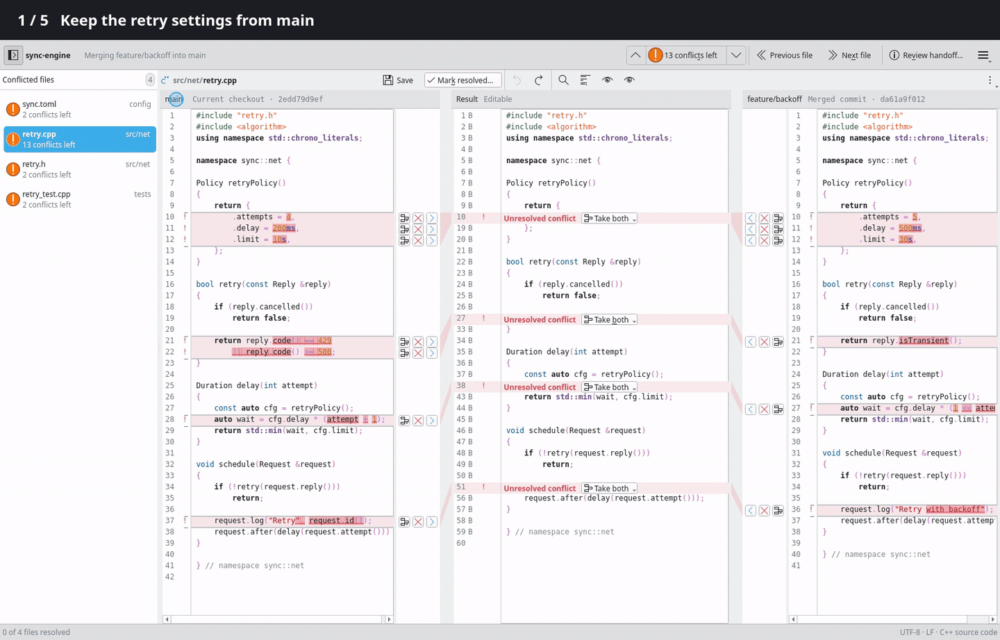
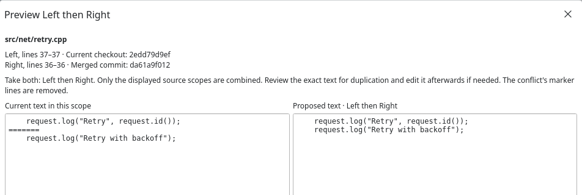
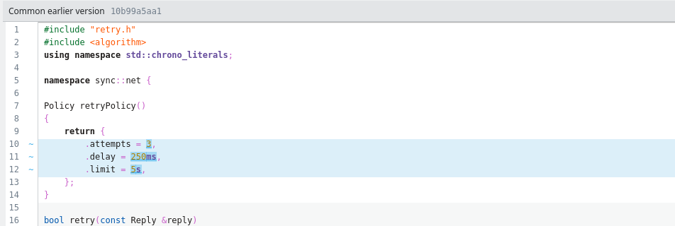

<h1>
  <picture>
    <source media="(prefers-color-scheme: dark)" srcset="assets/branding/svg/for-dark/branch-truce-horizontal.svg">
    
  </picture>
</h1>

A standalone text conflict resolver for Git on Linux and KDE. Review captured sources beside an editable result, track each file in the sidebar and return to your merge or rebase. Works offline, with no account.

**[Download](https://github.com/e0ipso/branch-truce/releases/latest)** · **[Get started](#use-it)** · **[Set up git mergetool](docs/mergetool.md#register-the-tool)**

<picture>
  <source media="(prefers-color-scheme: dark)" srcset="docs/images/comparison-dark.png">
  
</picture>

*Earlier light and dark captures, committed on 2026-10-29. They predate the current sidebar, gutter and menu changes. A fresh pair and updated installed-package measurements remain required; see [platform validation](docs/platform-validation.md#redesign-evidence-still-required).*

## See it in action



*Choose a change, see the result, undo it and try again. Open the common earlier version whenever you need context. [Watch the video](docs/images/demo.mp4).*

## Work through the conflict

<table>
  <tr>
    <th>Review the exact change</th>
    <th>Get the earlier context</th>
  </tr>
  <tr>
    <td><a href="docs/images/choice-preview.png"></a></td>
    <td><a href="docs/images/earlier-version.png"></a></td>
  </tr>
  <tr>
    <td>Accept, ignore or take both sides in either order. Preview broader changes before applying them, then edit the result yourself.</td>
    <td>See what both branches started from. Syntax highlighting, word-level differences and connected passages help you follow the changes.</td>
  </tr>
</table>

Step through remaining conflicts, find a passage, wrap long lines or reveal spaces and tabs. Choices and typing share an undo history.

Your work survives closing the window or a crash. Branch Truce restores edits and choices when you reopen the same merge or rebase. Files it cannot edit stay in the file list with a reason, so you can handle them in another tool.

## Install

Release targets are Kubuntu 26.04, Fedora 44 and Arch Linux, all on x86_64. Download the matching asset from the [latest release](https://github.com/e0ipso/branch-truce/releases/latest) when available.

| System | Package |
| --- | --- |
| Kubuntu 26.04 | `branch-truce_<version>_amd64-ubuntu26.04.deb` |
| Fedora 44 | `branch-truce-<native-version>-1.fc44.x86_64.rpm` |
| Arch Linux | `branch-truce-<native-version>-1-x86_64.pkg.tar.zst` |

Install the downloaded package with your system's package manager:

```sh
# Kubuntu
sudo apt install ./branch-truce_*_amd64-ubuntu26.04.deb
# Fedora
sudo dnf install ./branch-truce-*.fc44.x86_64.rpm
# Arch Linux
sudo pacman -U ./branch-truce-*-x86_64.pkg.tar.zst
```

Dated offscreen container results cover native package installation, smoke launch, upgrade and removal; those results apply to the recorded revisions. The user reports that the Kubuntu DEB also installs and works on Tuxedo OS; there is no separate Tuxedo release build. Container checks and that report do not establish compatibility across real desktop versions. See [target platforms](docs/target-platforms.md), the dated [desktop validation record](docs/platform-validation.md), or [build from source](docs/build.md).

## Use it

When Git stops a merge or rebase on conflicts, open the repository:

```sh
branch-truce                     # current repository
branch-truce /path/to/repository
```

The sidebar lists each file with its status, including work that needs another tool. A resolved row uses a positive status icon and text only after the result is verified in Git. The session toolbar steps through remaining conflicts; its conflict count is separate from the undecided source-decision count in the file row's tooltip. Save, Mark resolved, editing and reading controls are in the file toolbar, with a menu for overflow actions.

The left and right sources surround the editable result. Source headings distinguish their captured role from their commit identity, including during a rebase. Hover a source range to follow its connection to the result. Its compact controls put the Accept arrow toward the result and Ignore beside it. The range menu offers precise line choices, Resolve using this side and Take both in either order. Fully decided ranges keep their choices in the source text's context menu. The result gutter shows a line number and one state glyph; inspect the glyph for provenance and decisions.

1. Pick a file and compare the changes. Opening a session leaves your files and Git index untouched. Show the common earlier version when you need context.
2. Compose your result with source choices or direct edits. **Save** keeps a draft inside Branch Truce. **Mark resolved** writes the reviewed result and verifies that path's staging in Git. With `git mergetool`, it hands the result back to the waiting Git process and waits for staging confirmation.
3. Review the session handoff and return to your terminal to continue the merge or rebase. Branch Truce leaves continuing and committing to you.

The panes use the desktop's focus treatment and scroll bars. Short windows can scroll the work area; use the sidebar toggle and toolbar overflow to reach controls.

Prefer `git mergetool`? [Register Branch Truce](docs/mergetool.md#register-the-tool), then run:

```sh
git mergetool --tool=truce
```

## Contributing

See [build and test instructions](docs/build.md) to get started. The [knowledge base](.ai/kenkeep/ENTRY.md) records project conventions; [PRD.md](PRD.md) and [TECH_SPEC.md](TECH_SPEC.md) describe scope and architecture.

## License

[GPL-3.0-or-later](LICENSE).
